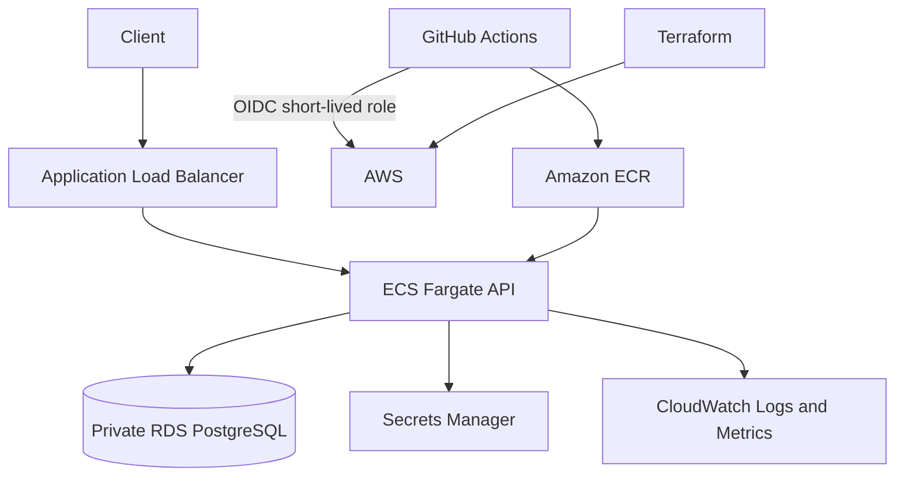

# Secure Task Manager — AWS DevSecOps Portfolio Project

A containerized FastAPI task-management API with PostgreSQL migrations, AWS infrastructure as code, and a security-focused GitHub Actions pipeline. This project demonstrates an end-to-end junior Cloud DevSecOps workflow: application testing, supply-chain checks, container security, Terraform validation, AWS identity federation, deployment, and operational monitoring.

## Architecture



**AWS components:** VPC, public ALB subnets, private database subnets, security groups, ALB, ECR, ECS Fargate, RDS PostgreSQL, Secrets Manager, IAM roles, GitHub OIDC, CloudWatch Logs, alarms, and dashboard.

The portfolio configuration currently places Fargate tasks in public subnets with public IP assignment to avoid NAT Gateway charges. The task security group permits inbound application traffic only from the ALB security group. RDS remains private. This is a documented cost trade-off for a disposable learning environment, not a production network recommendation. HTTPS requires an ACM certificate configured in Terraform.

## Application

- FastAPI REST API with task CRUD endpoints.
- SQLAlchemy database layer with SQLite for local development and PostgreSQL for AWS.
- Alembic versioned migrations.
- Liveness endpoint: `GET /health`.
- Database readiness endpoint: `GET /ready`.
- Non-root Docker runtime; ECS task runs with the matching UID.
- AWS runtime supports the `DB_HOST`, `DB_PORT`, `DB_NAME`, `DB_USER`, and `DB_PASSWORD` variables. The password is injected from the RDS-managed Secrets Manager secret.

## Run locally

Requirements: Docker and Docker Compose.

```bash
cp .env.example .env
docker compose up --build
```

API documentation: http://localhost:8000/docs

Useful checks:

```bash
curl http://localhost:8000/health
curl http://localhost:8000/ready
curl http://localhost:8000/tasks/
```

To stop the local stack:

```bash
docker compose down
```

## Security and delivery pipeline

The GitHub Actions workflow runs:

1. PostgreSQL-backed Alembic migration and pytest suite with an 85% coverage threshold.
2. Bandit static security analysis.
3. pip-audit dependency vulnerability audit.
4. Semgrep static analysis.
5. Docker image build and Trivy HIGH/CRITICAL vulnerability scan.
6. Container runtime smoke tests, including readiness and task creation.
7. Terraform formatting, initialization, validation, and Checkov scanning.

AWS deployment is manual via `.github/workflows/deploy-aws.yml`. It authenticates with GitHub OIDC, pushes an immutable commit-SHA image to ECR, runs database migrations as a one-off ECS task, deploys a new ECS task definition, waits for service stability, and verifies `/ready`. No long-lived AWS access keys are required.

## Deploy to AWS

1. Review the resources and estimated regional costs in `terraform/README.md`.
2. Configure AWS CLI credentials locally.
3. Copy `terraform/example.tfvars` to `terraform/terraform.tfvars`; configure the AWS region, repository, deployment branch, and ACM certificate if HTTPS is required.
4. Run `terraform init`, `terraform fmt -check -recursive`, `terraform validate`, and `terraform plan`.
5. Review the plan and apply only when you explicitly accept the cost and resource changes.
6. Configure the repository Actions variables listed in `terraform/README.md`.
7. Run the **Deploy Secure Task Manager to AWS** workflow manually.

The Terraform configuration enables RDS-managed master credentials in Secrets Manager. Terraform state still contains sensitive infrastructure metadata and must be protected. Do not commit `terraform.tfstate`, `.tfvars`, or real secrets.

## Project status

This branch is the integration workspace for the AWS deployment. The application and infrastructure changes must pass GitHub Actions and be reviewed before merging into `main`. AWS resources are not created by CI; deployment requires a separately reviewed Terraform plan and explicit manual apply.

## Repository layout

- `app/` — FastAPI application, SQLAlchemy models, database layer, and routes.
- `alembic/` — database migration environment and versioned migrations.
- `tests/` — API, database configuration, and health/readiness tests.
- `terraform/` — AWS infrastructure and outputs.
- `docs/architecture.md` — architecture and engineering decisions.
- `docs/security-exceptions.md` — explicit Checkov exceptions and their production boundaries.
- `.github/workflows/` — CI security gates and manual AWS deployment workflow.
