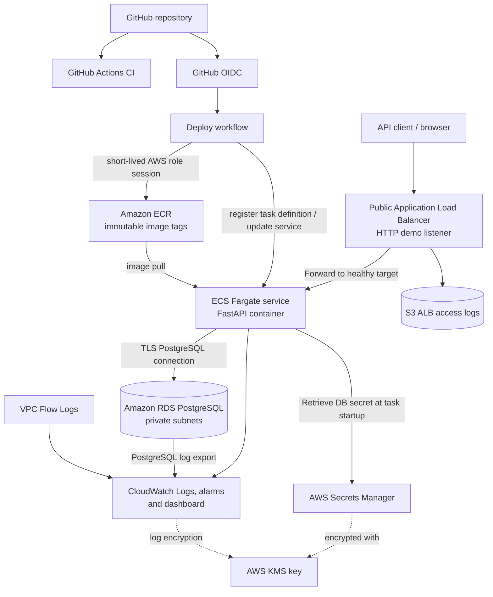

# Architecture and data flow

## Overview

The deployed portfolio environment runs a FastAPI service on Amazon ECS Fargate behind a public Application Load Balancer (ALB). PostgreSQL is hosted by Amazon RDS in private database subnets. Terraform manages the infrastructure, and GitHub Actions uses OIDC to publish and deploy immutable container images.

## Architecture diagram

## Request path and trust boundaries

1. A client connects to the public ALB.
2. The ALB forwards requests to the ECS Fargate target group after its `/ready` health check succeeds.
3. The ECS service runs the FastAPI container. The application security group permits inbound application traffic only from the ALB security group.
4. The API reads and writes task records in RDS PostgreSQL. RDS is not publicly accessible and its security group permits PostgreSQL ingress only from the application security group.
5. The ECS task execution role retrieves the database password from Secrets Manager. The secret is encrypted with the project KMS key.
6. Container logs, RDS PostgreSQL logs, and VPC Flow Logs are sent to CloudWatch. ALB access logs are delivered to a private S3 bucket.

## AWS components

| Layer | Component | Implemented configuration |
|---|---|---|
| Network | VPC | Dedicated project VPC, two public subnets and two private DB subnets across pinned AZs |
| Edge | ALB | Public ALB, deletion protection, invalid-header dropping, health-checked target group, access logging |
| Compute | ECS Fargate | One desired task; task ingress is limited to the ALB security group |
| Registry | ECR | Immutable tags, scan on push, lifecycle retention policy, AES-256 repository encryption |
| Database | RDS PostgreSQL | Private, encrypted at rest, single-AZ, deletion protection, one-day backup retention |
| Credentials | Secrets Manager | Generated database password encrypted with the project KMS key |
| Key management | AWS KMS | Customer-managed key with automatic key rotation |
| Observability | CloudWatch | Application log group, VPC Flow Log group, alarms, operations dashboard |
| Network visibility | VPC Flow Logs | All traffic captured |
| Edge audit | S3 | ALB access log bucket with public access blocked and server-side encryption |
| Delivery identity | GitHub OIDC | Branch-restricted role assumption; no long-lived AWS access keys in GitHub |

## CI and deployment flow

### Continuous integration

On pushes and pull requests to configured branches, GitHub Actions:

1. Starts PostgreSQL for integration tests.
2. Installs pinned runtime and development dependencies.
3. Applies Alembic migrations.
4. Runs pytest with an 85% coverage threshold.
5. Runs Bandit and pip-audit.
6. Builds the Docker image and scans it with Trivy (CRITICAL severity, ignore-unfixed).
7. Starts the image and tests readiness plus task CRUD smoke behavior.
8. Runs Terraform formatting, initialization, validation, and Checkov.

Checkov is configured with `--soft-fail`. Its findings are visible in the job log but do not fail the workflow; see the [residual-risk register](security/residual-risk-register.md).

### AWS deployment

The manually dispatched deployment workflow:

1. Requests short-lived AWS credentials using GitHub OIDC.
2. Builds and pushes a container image tagged with the commit SHA.
3. Registers a new ECS task definition referencing that image.
4. Runs database migrations in a one-off Fargate task.
5. Updates the ECS service and waits for it to become stable.
6. Calls the configured application `/ready` endpoint.

## Deliberate portfolio trade-offs

- **HTTP at the edge:** No ACM certificate/custom domain is configured for the current demo. The Terraform configuration supports HTTPS and HTTP-to-HTTPS redirect when an ACM certificate ARN is provided. Until then, do not send sensitive data through the public endpoint.
- **Public-subnet Fargate tasks:** To avoid a NAT Gateway cost, tasks receive public IPs in public subnets. Their security group still accepts inbound application traffic only from the ALB security group. A stricter production design would use private task subnets with NAT or the required VPC endpoints.
- **Single-AZ RDS:** Multi-AZ is disabled to control portfolio cost. This is not a high-availability database configuration.
- **RDS monitoring/authentication options:** Enhanced Monitoring, Performance Insights, and IAM database authentication are not enabled in the current cost-conscious configuration. Database credentials are supplied through Secrets Manager.
- **ECR encryption:** The repository uses AES-256 encryption rather than a customer-managed KMS key. This avoids a repository replacement in the existing environment.
- **Log retention:** VPC Flow Logs use a shorter retention period than the application log group to limit storage cost.

## Operational endpoints

- `/health`: process liveness.
- `/ready`: readiness including a database connectivity check.
- `/docs`: interactive OpenAPI documentation.
